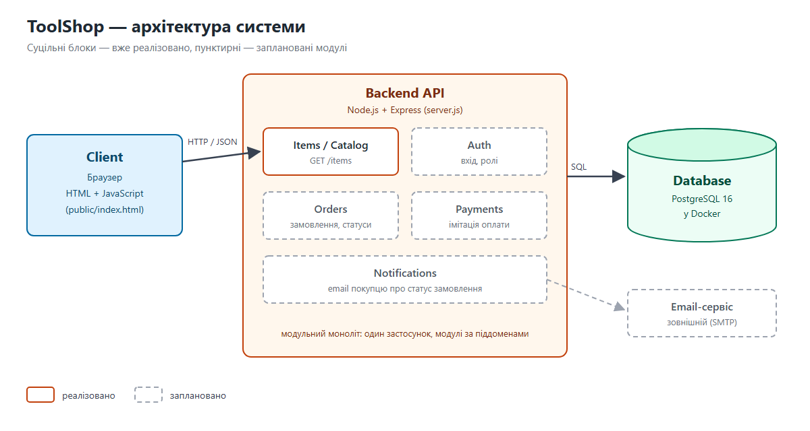

# ToolShop — архітектура

Джерело діаграми: [architecture_diagram.svg](architecture_diagram.svg).

## Що означає кожен блок

| Блок | Стан | Призначення |
|------|------|-------------|
| **Client** | реалізовано | Сторінка в браузері (HTML + JavaScript). Надсилає HTTP-запити до API й показує отримані дані. |
| **Backend API** | реалізовано | Сервер на Node.js + Express. Приймає запити клієнта, виконує бізнес-логіку, звертається до БД. Будується як модульний моноліт: один застосунок, усередині — модулі за піддоменами. |
| **Items / Catalog** | реалізовано | Каталог товарів. Зараз — `GET /items`, далі повний CRUD товарів і категорій. |
| **Auth** | заплановано | Реєстрація, вхід, ролі (гість / покупець / менеджер) і перевірка доступу. |
| **Orders** | заплановано | Оформлення замовлень, позиції замовлення, статуси «Нове → Підтверджене → Відправлене». |
| **Payments** | заплановано | Імітація оплати замовлення (реальні платежі система не проводить). |
| **Notifications** | заплановано | Листи покупцю при зміні статусу замовлення. |
| **Database** | реалізовано | PostgreSQL 16 у Docker-контейнері. Зберігає товари, а згодом — користувачів і замовлення. |
| **Email-сервіс** | заплановано | Зовнішній поштовий сервіс (SMTP), через який Notifications надсилає листи. |

## Потоки даних

- **Client → Backend API:** HTTP-запити з JSON-відповідями (`GET /items`).
- **Backend API → Database:** SQL-запити через бібліотеку `pg`.
- **Notifications → Email-сервіс:** надсилання листів (заплановано).
